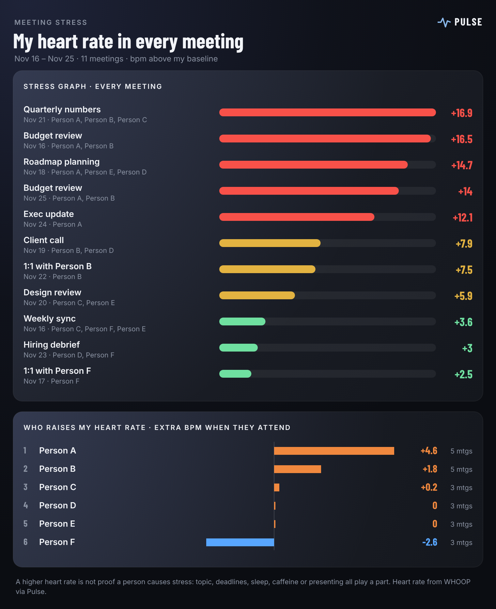

# Pulse: heart-rate & tension journal

Pulse records your live heart rate from a WHOOP strap (via **Heart Rate Broadcast** over Bluetooth) while you watch your teams and races, or during meetings and workouts. For football and F1, **what happens in the game is logged automatically** from live data. You just tap **Watch** (even mid-match) and add your own reactions if you like. Afterwards you get a chart, an AI write-up and a shareable image.

**App:** https://joelmadeira26.github.io/stress-tracking-whoop/


## Following & automatic moments
- **Following tab**: your teams (default Sporting CP, Manchester United, Portugal), "every game in" competitions (default Liga Portugal, Premier League, Champions League, Europa League; more available), and any number of F1 drivers (default Max Verstappen). When you watch a race you pick whose race it is.
- **Home** shows only live and upcoming games; finished ones drop off.
- **Same format everywhere**: football, F1, meetings and work days all use the reference chart: numbered moments, shaded bands (safety car, half-time, speaking, meetings), the category key, the story line "… (your clock, …)", heart-rate "Your reaction" moments and AI-written captions.
- **Home** lists what's live now and coming up in the next 9 days. Tap **Watch** at any time.
- **Football (ESPN live data)**: goals with the running score and scorer, red cards, missed or saved penalties, VAR decisions, shots off the woodwork, kick-off, half-time and full time, all with their real-world times.
- **F1 (OpenF1)**: lights out, lead changes (grouped, e.g. "Laps 10 to 18: lead swaps back and forth between Max and Russell"), your driver's pit stops, safety car / VSC / red-flag bands, and the result. OpenF1 may publish timing only after the race; Pulse then fills in the moments when you save or open the session.
- **Stream delay & sync**: streams run 30–90 s (sometimes minutes) behind live data. Moments appear when they'd be on your screen (default 60 s). During a session tap **Sync stream**:
  - Football: type the match clock a few seconds ahead of your stream (e.g. `67:30`, `45+2:10`, `90+3:05`) and tap **Sync now** when your stream shows it. Or use **Kick-off now** / **2nd half now**.
  - F1: type the next lap number and tap **Sync now** when your stream's lap counter changes. Or use **Lights out, right now**. If F1 timing is only published after the race, the sync is saved and applied automatically when it arrives.
  - **Just saw it** on the latest moment works too. Your last sync becomes the default for next time; on a saved session you can nudge ±10 s / ±1 min.
- **Your reactions** (So nervous, Big chance!, Celebrating, Furious, Can't watch, or free text) are tagged with the match minute.
- Sources: ESPN's public site API and OpenF1 (unofficial, not associated with Formula 1). Both are called straight from your phone; no server.

## Meeting stress (a stress graph for every meeting)
Inspired by the WHOOP "stress leaderboard" project: see which meetings, and which people, raise your heart rate.
- **Record a meeting:** add who's there, start 2–3 minutes early, then tap **Meeting starts now**. The minutes before become your baseline, and Pulse reports how many bpm above it you were (e.g. +11.3).
- **Add manually:** for meetings you didn't record, enter the average (and peak) heart rate from the WHOOP app's graph for that time, plus who was there.
- **Stress graph:** every meeting ranked by bpm above baseline.
- **Who raises your heart rate:** each person's estimated extra bpm. It uses ridge regression over who attended, so people who often share meetings are separated, and people with few meetings are pulled towards 0. **Hide names** turns everyone into Person A, B… (also inside meeting titles) before you share.
- **Share stress board:** a 1520 px image of both rankings.
- Caveat shown in the app: a higher heart rate is not proof someone causes stress; topic, deadlines, sleep, caffeine or presenting all play a part.



## Work day mode + Google Calendar (every meeting scored automatically)
WHOOP's official API has no minute-by-minute heart rate, and a phone browser can't call it at all. So Pulse records your all-day heart rate itself, over Bluetooth, and lines it up with your calendar:
1. Connect Google Calendar once (below).
2. In the morning: **Meeting stress → Start work day**. Leave the phone on its charger with Pulse open; the screen stays on.
3. Today's meetings show live, with the current one highlighted.
4. **End work day**: every meeting with heart rate for at least half its length is scored against your heart rate in the 90 minutes around it, outside other meetings. That's the same method as the WHOOP "stress leaderboard" project. Attendees come from the invite and feed the people leaderboard.

When you record a single meeting, Pulse offers the meetings happening now from your calendar to fill in the title and people.

### Google Calendar setup
Takes about 5 minutes, once, on a computer:
1. Open https://console.cloud.google.com, sign in with the Google account that has your work calendar, and create a project called **Pulse**.
2. **APIs & Services → Library**: search **Google Calendar API** and click **Enable**.
3. **APIs & Services → OAuth consent screen**:
   - choose **External** (or **Internal** for a Google Workspace account);
   - app name **Pulse**, with your email as support and developer contact;
   - under **Scopes**, add `.../auth/calendar.events.readonly`;
   - under **Test users**, add your own Google account.
4. **APIs & Services → Credentials → Create credentials → OAuth client ID**:
   - application type **Web application**;
   - under **Authorised JavaScript origins**, add `https://joelmadeira26.github.io`;
   - click **Create** and copy the **Client ID**.
5. In Pulse: **Settings → Google Calendar**: paste the client ID, tap **Connect Google Calendar**, sign in and allow.

Notes:
- Access is read-only and goes straight from Google to your phone.
- Google sign-ins last an hour. When one expires, Pulse asks you to tap **Connect** again.
- On a company Google Workspace account, your admin may need to allow the app.

## Costs: everything is free except the AI
| Service | Used for | Cost |
|---|---|---|
| ESPN public data | football fixtures, live scores, match events | free, no key |
| API-Football free tier | backup live scores when ESPN is down | free key; Pulse calls it at most once a minute and 90 times a day (limit is 100) |
| OpenF1 free data | F1 schedule, lead changes, safety car, results | free, no key; moments fill in after the race |
| Google Calendar API | your meetings | free |
| Cloudflare Worker (WHOOP relay) | WHOOP recovery, sleep, HRV | free plan |
| GitHub Pages | hosting the app | free |
| **Anthropic API** | AI analysis and captions | **paid per use**: Haiku 5.5 ≈ 0.1–0.2¢, Sonnet 5.5 ≈ 1–2¢, Opus 5.5 ≈ 2–4¢ per analysis |

To keep AI costs down, pick **Haiku 5.5** and **Quick** depth in Settings, or turn off **Analyse automatically** and only analyse the sessions you want to share.

## Settings (everything can be changed or switched off)
Settings save automatically and are grouped as follows:
- **You:** resting heart rate, and a personal stress scale that adapts to your own heart-rate range after 8+ recordings.
- **Display:** dark, light or match-my-phone; normal or large text.
- **Heart-rate strap**
- **Live sport data:**
  - stream delay;
  - big chances on/off;
  - calendar reminder lead time;
  - backup live scores (API-Football free tier, capped at 90 calls a day).
- **Google Calendar:** client ID, connect, keep in sync.
- **WHOOP account (official API):** relay URL, connect, sync now, resting HR updated daily. See [relay/README.md](relay/README.md).
- **Meetings:**
  - ignore the first minutes;
  - baseline window;
  - minimum coverage;
  - hide names by default;
  - PIN lock with optional fingerprint/face unlock.
- **AI analysis:** key, model, analyse automatically.
- **Features:** "Your reaction" moments, weekly summary.
- **Demos, export, restore from an export, setup guide, clear all data.**

Also new:
- a first-launch setup guide;
- a data-quality badge and WHOOP recovery/sleep/HRV chips on each session;
- an explorable chart (tap markers, zoom 1×/2×/4×);
- a weekly summary;
- "Remind me" / "Add to calendar" (.ics with an alert) for your games and races.

## Features
- **Live**: big BPM, session clock (football match minute: 1'–45', 45+x', HT, 46'–90', 90+x', FT), live chart, thumb-sized tag buttons, free-text tags, Undo, and End (tap twice to confirm).
- **Session types**: *Football* and *F1* with automatic moments from live data, *Other match* (tag moments yourself), and *Meeting* (attendees, baseline, "I'm speaking" band).
- **Chart**: 10-second heart-rate averages (blue, left axis) and stress (green→yellow, 0–3, right axis). Numbered tag circles, staggered into up to 3 rows. Shaded bands (half-time, speaking, sets), kick-off and full-time lines, and gaps marked where the strap dropped out. Rendered as SVG at real pixel size, and redrawn when the screen resizes.
- **End screen**: notes, forgotten moments (minute + label), and quick stats (duration, average and peak HR with what was happening at the peak, time above calm).
- **AI write-up**: Anthropic Messages API called straight from the browser. Your key is stored only on your device.
- **Share to social**: a share sheet with three formats, each with the chart and the numbered captions list:
  - **Classic** (1520 px wide, the reference layout) for X, WhatsApp and LinkedIn
  - **Post 4:5** (1080×1350) for the Instagram and LinkedIn feeds
  - **Story 9:16** (1080×1920, with peak, average and stress-peak chips) for Instagram and WhatsApp status

  It comes with a ready-written, editable caption ("I tracked my heart rate and stress during…" plus hashtags). It's shared with the image and copied for apps that ignore shared text. There's also a Save image fallback.
- **History**: filter by type, sparklines, and an average-peak comparison across types.
- **Reliability**: Screen Wake Lock, auto-reconnect with increasing waits, autosave every 5 s with "Resume your session?", and IndexedDB storage.
- **PWA**: installable and works offline (service worker: network-first, cache fallback).

### Stress (Pulse's own estimate)
WHOOP's Stress Monitor isn't available over Bluetooth, so Pulse estimates stress from 0 to 3 every 30 s:
- HR part = (60 s average HR − resting HR) / 15, clamped to 0–3
- HRV part (when RR intervals arrive) = 1.5 × log2(baseline RMSSD / current 60 s RMSSD) + 1, clamped to 0–3. The baseline comes from the period before kick-off (if at least 2 min) or the first 5 minutes.
- Stress = the average of the available parts.

"Calm" means at or below resting HR + 15 bpm.

## Adding a new session type
All types live in **`js/config.js` → `SESSION_TYPES`**. Add one entry:

```js
podcast: {
  label: 'Recording a podcast',
  short: 'Podcast',
  icon: 'chat',               // key from ICONS in the same file
  defaultMode: 'doing',       // 'watching' | 'doing'
  clock: 'elapsed',           // or 'match' for a football-style minute
  titleHint: 'Episode 12',
  toggle: { key: 'live', button: 'On air', label: 'On air', color: '#f472b6' }, // optional band
  tags: [
    { key: 'laugh', label: 'Big laugh', color: '#34d399' },
    { key: 'flub',  label: 'Flubbed it', color: '#f87171' },
  ],
},
```

The Start button, live tag buttons, history filter and chart all pick it up automatically. For a demo, add a generator to `DEMOS` in `js/demo.js`.

## Files
```
index.html               app shell
css/styles.css           design
js/config.js             session types, tags, moment categories, competitions, default follows
js/feeds.js              live data: ESPN football + OpenF1 (fixtures, parsing, sync)
js/hr.js                 0x2A37 heart-rate parser + 1 Hz aggregator
js/ble.js                Web Bluetooth connection + auto-reconnect
js/analysis.js           buckets, tension, match clock, stats
js/chart.js              chart (one drawing routine → SVG on screen, canvas for PNG)
js/export.js             PNG export + Web Share
js/ai.js                 AI write-up request
js/db.js                 IndexedDB storage
js/demo.js               demo sessions
js/app.js                screens, routing, live session
sw.js, manifest.webmanifest, icons/   PWA
tests/                   unit tests (node) + browser end-to-end test (Playwright)
```

## Running locally & tests
No build step. Serve the folder over HTTP, for example with `python3 -m http.server 8080`, and open http://localhost:8080 (Web Bluetooth works on localhost).

```
npm run test:unit   # HR parser, stress, match clock, chart, mocked AI, and feed parsers on
                    # real recorded data (Las Vegas GP 2026, Liverpool 4–0 Man Utd)
npm run test:e2e    # headless Chromium: fake strap + fake live feeds: join a live match mid-way,
                    # auto goal after stream delay, typed-clock sync, 'Just saw it', reconnect,
                    # resume after reload, end screen, mocked AI, PNG export + share, 360 px & desktop
```
