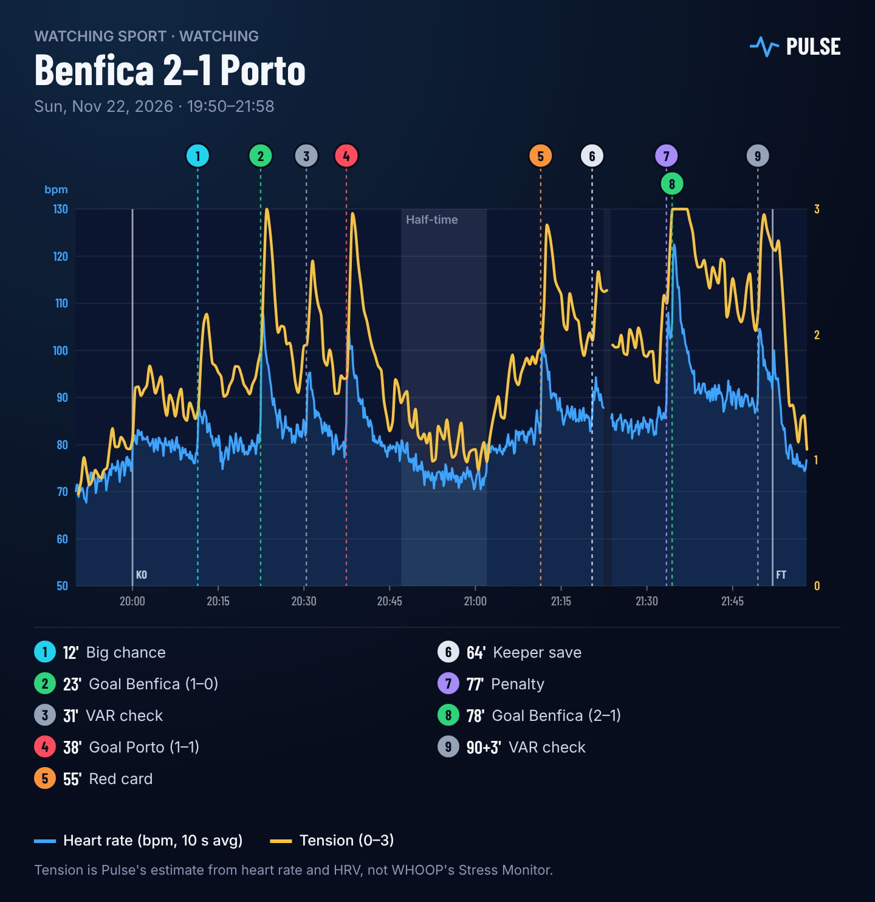

# Pulse: heart-rate & tension journal

Pulse records your live heart rate from a WHOOP strap (via **Heart Rate Broadcast** over Bluetooth) while you watch your teams and races, or during meetings and workouts. For football and F1, **what happens in the game is logged automatically** from live data. You just tap **Watch** (even mid-match) and add your own reactions if you like. Afterwards you get a chart, an AI write-up and a shareable image.

**App:** https://joelmadeira26.github.io/stress-tracking-whoop/



## Following & automatic moments
- **Following tab**: your teams (default Sporting CP, Manchester United, Portugal), "every game in" competitions (default Liga Portugal, Premier League, Champions League, Europa League; more available), and your F1 driver (default Max Verstappen).
- **Home** lists what's live now and coming up in the next 9 days. Tap **Watch** at any time.
- **Football (ESPN live data)**: goals with the running score and scorer, red cards, missed or saved penalties, VAR decisions, shots off the woodwork, kick-off, half-time and full time, all with their real-world times.
- **F1 (OpenF1)**: lights out, lead changes (grouped, e.g. "Laps 10 to 18: lead swaps back and forth between Max and Russell"), your driver's pit stops, safety car / VSC / red-flag bands, and the result. OpenF1 may publish timing only after the race; Pulse then fills in the moments when you save or open the session.
- **Stream delay & sync**: streams run 30–90 s (sometimes minutes) behind live data. Moments appear when they'd be on your screen (default 60 s). During a session tap **Sync stream**:
  - Football: type the match clock a few seconds ahead of your stream (e.g. `67:30`, `45+2:10`, `90+3:05`) and tap **Sync now** when your stream shows it. Or use **Kick-off now** / **2nd half now**.
  - F1: type the next lap number and tap **Sync now** when your stream's lap counter changes. Or use **Lights out, right now**. If F1 timing is only published after the race, the sync is saved and applied automatically when it arrives.
  - **Just saw it** on the latest moment works too. Your last sync becomes the default for next time; on a saved session you can nudge ±10 s / ±1 min.
- **Your reactions** (So nervous, Big chance!, Celebrating, Furious, Can't watch, or free text) are tagged with the match minute.
- Sources: ESPN's public site API and OpenF1 (unofficial, not associated with Formula 1). Both are called straight from your phone; no server.

## Features
- **Live**: big BPM, session clock (football match minute: 1'–45', 45+x', HT, 46'–90', 90+x', FT), live chart, thumb-sized tag buttons, free-text tags, Undo, and End (tap twice to confirm).
- **Session types**: *Watching sport* (phase button, goals per team with a running score, big chance, penalty, red card, VAR), *Meeting* ("I'm speaking" band), *Workout* ("Set / interval" band).
- **Chart**: 10-second heart-rate averages (blue, left axis) and stress (green→yellow, 0–3, right axis). Numbered tag circles, staggered into up to 3 rows. Shaded bands (half-time, speaking, sets), kick-off and full-time lines, and gaps marked where the strap dropped out. Rendered as SVG at real pixel size, and redrawn when the screen resizes.
- **End screen**: notes, forgotten moments (minute + label), and quick stats (duration, average and peak HR with what was happening at the peak, time above calm).
- **AI write-up**: Anthropic Messages API called straight from the browser. Your key is stored only on your device.
- **Share**: 1440 px PNG (2x) with title, date and time range, chart, numbered legend and the Pulse mark, sent through the Web Share API (WhatsApp, Instagram, LinkedIn…), with a download fallback.
- **History**: filter by type, sparklines, and an average-peak comparison across types.
- **Reliability**: Screen Wake Lock, auto-reconnect with increasing waits, autosave every 5 s with "Resume your session?", and IndexedDB storage.
- **PWA**: installable and works offline (service worker: network-first, cache fallback).

### Stress (Pulse's own estimate)
WHOOP's Stress Monitor isn't available over Bluetooth, so Pulse estimates stress from 0 to 3 every 30 s:
- HR part = (60 s average HR − resting HR) / 15, clamped to 0–3
- HRV part (when RR intervals arrive) = 1.5 × log2(baseline RMSSD / current 60 s RMSSD) + 1, clamped to 0–3. The baseline comes from the period before kick-off (if at least 2 min) or the first 5 minutes.
- Stress = the average of the available parts.

"Calm" means at or below resting HR + 15 bpm.

## Adding a new session type
All types live in **`js/config.js` → `SESSION_TYPES`**. Add one entry:

```js
podcast: {
  label: 'Recording a podcast',
  short: 'Podcast',
  icon: 'chat',               // key from ICONS in the same file
  defaultMode: 'doing',       // 'watching' | 'doing'
  clock: 'elapsed',           // or 'match' for a football-style minute
  titleHint: 'Episode 12',
  toggle: { key: 'live', button: 'On air', label: 'On air', color: '#f472b6' }, // optional band
  tags: [
    { key: 'laugh', label: 'Big laugh', color: '#34d399' },
    { key: 'flub',  label: 'Flubbed it', color: '#f87171' },
  ],
},
```

The Start button, live tag buttons, history filter and chart all pick it up automatically. For a demo, add a generator to `DEMOS` in `js/demo.js`.

## Files
```
index.html               app shell
css/styles.css           design
js/config.js             session types, tags, moment categories, competitions, default follows
js/feeds.js              live data: ESPN football + OpenF1 (fixtures, parsing, sync)
js/hr.js                 0x2A37 heart-rate parser + 1 Hz aggregator
js/ble.js                Web Bluetooth connection + auto-reconnect
js/analysis.js           buckets, tension, match clock, stats
js/chart.js              chart (one drawing routine → SVG on screen, canvas for PNG)
js/export.js             PNG export + Web Share
js/ai.js                 AI write-up request
js/db.js                 IndexedDB storage
js/demo.js               demo sessions
js/app.js                screens, routing, live session
sw.js, manifest.webmanifest, icons/   PWA
tests/                   unit tests (node) + browser end-to-end test (Playwright)
```

## Running locally & tests
No build step. Serve the folder over HTTP, for example with `python3 -m http.server 8080`, and open http://localhost:8080 (Web Bluetooth works on localhost).

```
npm run test:unit   # HR parser, stress, match clock, chart, mocked AI, and feed parsers on
                    # real recorded data (Las Vegas GP 2026, Liverpool 4–0 Man Utd)
npm run test:e2e    # headless Chromium: fake strap + fake live feeds: join a live match mid-way,
                    # auto goal after stream delay, typed-clock sync, 'Just saw it', reconnect,
                    # resume after reload, end screen, mocked AI, PNG export + share, 360 px & desktop
```
